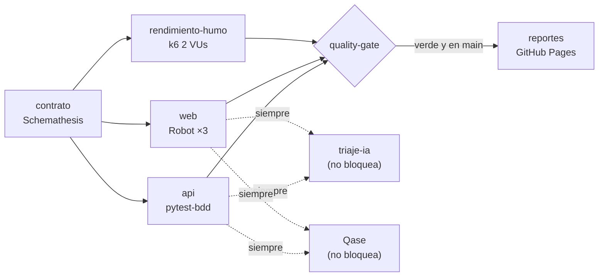

# Informe final del proyecto · Grupo G2 (individual)

**Módulo:** G2 · Pago de servicios y afiliaciones · **Integrante:** David Marcelo · **Curso:** CS5383 Pruebas y Verificación de Software
**Evidencia publicada:** https://deyvydt.github.io/qolqe-wallet-services/

## Índice

1. [Alcance](#1-alcance)
2. [Arquitectura y herramientas](#2-arquitectura-y-herramientas)
3. [Patrón de diseño](#3-patrón-de-diseño)
4. [Cobertura: reporte total de escenarios](#4-cobertura-reporte-total-de-escenarios)
5. [Pipeline CI/CD y quality gates](#5-pipeline-cicd-y-quality-gates)
6. [Trazabilidad con ejecuciones múltiples](#6-trazabilidad-con-ejecuciones-múltiples)
7. [Capacidad de IA en el pipeline: triaje de fallas](#7-capacidad-de-ia-en-el-pipeline-triaje-de-fallas)
8. [Defectos](#8-defectos)
9. [Rendimiento](#9-rendimiento)
10. [Conclusiones, limitaciones y trabajo futuro](#10-conclusiones-limitaciones-y-trabajo-futuro)

---

## 1. Alcance

| Parte | Nivel de prueba | Qué cubre |
|---|---|---|
| 1 · API | Integración por la interfaz HTTP | Los 9 endpoints `/api/servicios/*` (E1–E9) y el proceso diario de débitos (E10), con escenarios funcionales y técnicos |
| 2 · Web + CI/CD | Sistema (E2E en navegador) | Núcleo común (HU-N-01…09) y G2 (HU-G2-01…07) por pantalla. Pipeline en GitHub Actions |
| 3 · Rendimiento | Sistema (carga) | Requerimiento «Quincena Qolqe»: carga, pico, estrés y resistencia con k6 |

**Criterio de priorización: riesgo.** Primero lo que mueve dinero o expone datos (HU-G2-01, HU-G2-02, comprobantes de otro usuario), luego lo que el sistema hace solo (débito automático, HU-G2-05) y al final la comodidad (alias, filtros). Por web va solo lo que el usuario **ve y hace**; los cálculos por día, la concurrencia y el contrato se quedan en la API, que es más rápida y estable (pirámide de pruebas).

---

## 2. Arquitectura y herramientas

```mermaid
flowchart LR
    subgraph SUT["Qolqe Wallet (FastAPI + SQLite) · NO se modifica"]
        API["API REST /api/*<br/>contrato /openapi.json"]
        UI["Web /servicios, /login…<br/>(data-testid)"]
        SOP["API de soporte /api/pruebas/*<br/>reiniciar · reloj · saldo · procesar-diario"]
    end

    subgraph SPEC["Especificación"]
        REQ["docs/requisitos.md<br/>HU · CA · reglas"]
        FAPI["features/api/*.feature<br/>Gherkin (es)"]
        FE2E["features/e2e/*.feature<br/>Gherkin (es)"]
    end

    REQ --> FAPI & FE2E

    FAPI --> BDD["pytest-bdd + httpx<br/>(TestClient, en proceso)"]
    BDD --> API
    BDD --> SOP
    ST["Schemathesis<br/>(desde el contrato)"] --> API

    FE2E --> RF["Robot Framework<br/>+ GherkinParser"]
    RF --> PO["Page Objects<br/>tests/e2e/pages"] --> BR["Browser Library<br/>(Playwright, Chromium)"] --> UI

    K6["k6<br/>tests/performance/qolqe.js"] --> API

    subgraph CI["GitHub Actions"]
        PIPE["contrato → api ‖ web ‖ rendimiento-humo<br/>→ quality-gate → reportes"]
    end
    BDD & ST & RF & K6 -.JUnit XML / output.xml / JSON.-> PIPE
    PIPE --> PAGES["GitHub Pages<br/>reportes + matriz de trazabilidad"]
    PIPE --> QASE["Qase<br/>historial de runs por caso"]
    PIPE --> TRI["Triaje de fallas<br/>(GitHub Models, solo sugiere)"]
```

### 2.1 Justificación de cada herramienta frente a alternativas

| Necesidad | Elegida | Alternativas evaluadas | Por qué la elegida |
|---|---|---|---|
| API funcional en BDD | **pytest + pytest-bdd + httpx** | Behave, Karate, Postman/Newman | Mismo lenguaje que el SUT (Python) → `TestClient` llama a la app **en proceso**, sin red ni servidor: rápido y estable. Fixtures y `parametrize` de pytest, marcas por etiqueta Gherkin (`-m "E3 and tecnico"`), `xfail strict` para defectos conocidos, JUnit/HTML nativos. **Behave** también lee Gherkin, pero no tiene fixtures ni el ecosistema de plugins de pytest (HTML, xfail, Schemathesis en la misma corrida). **Karate** obliga a JVM y a su propio DSL. **Postman/Newman**: colecciones JSON difíciles de revisar en un PR y sin Gherkin |
| API técnica (contrato) | **Schemathesis** | Dredd | Genera cientos de casos **basados en propiedades** desde `/openapi.json` (tipos, obligatoriedad, cabeceras, métodos no declarados) y corre dentro de pytest. **Dredd** solo valida los ejemplos del contrato (no hace *fuzzing*) y su mantenimiento está detenido |
| Web E2E | **Robot Framework + Browser Library** (+ `robotframework-gherkin-parser`) | Cypress, Playwright Test, Selenium | Browser usa **Playwright** por dentro (auto-espera, trazas, headless), pero con **keywords legibles** y reportes `report.html`/`log.html` con capturas sin configurar nada. El parser permite que el `.feature` en español sea el caso ejecutable. **Cypress** y **Playwright Test** exigen JavaScript/TypeScript (el resto del proyecto es Python). **Selenium** no espera solo: más esperas manuales y más fragilidad |
| Rendimiento | **k6** | JMeter, Locust (y Gatling, Artillery) | Umbrales como código (`thresholds`) que devuelven código de salida ≠ 0 → sirven de **quality gate**; bajo consumo por VU (goroutines), clave porque generador y app comparten la misma máquina. **Locust** es Python, pero por el GIL necesita varios procesos para escalar y le quita CPU a la app. **JMeter**: un hilo de JVM por usuario y planes `.jmx` en XML difíciles de versionar. Detalle: [`docs/rendimiento/herramienta.md`](rendimiento/herramienta.md) |
| Gestión de pruebas / historial | **Qase** | TestRail, Xray, Zephyr Scale, Kiwi TCMS | Plan gratuito, sin Jira ni servidor propio, API REST simple para subir cada run desde el pipeline. **TestRail** es de pago; **Xray** y **Zephyr** requieren Jira; **Kiwi TCMS** es gratis pero hay que instalar y mantener un servidor. Detalle: [`docs/trazabilidad-qase.md`](trazabilidad-qase.md) |
| CI/CD y publicación | **GitHub Actions + GitHub Pages** | GitLab CI, Jenkins | El repositorio ya vive en GitHub: sin infraestructura extra, protección de rama ligada al check, Pages gratis para la evidencia y `GITHUB_TOKEN` con acceso a GitHub Models para el triaje |

---

## 3. Patrón de diseño

### 3.1 E2E (web): comparación

Escala: ✅ fuerte · ➖ medio · ❌ débil.

| Criterio | **Page Object** (elegido) | Screenplay | Keyword-driven puro | App Actions |
|---|---|---|---|---|
| Idea | Un archivo por pantalla con sus localizadores y acciones | Actores con habilidades que ejecutan tareas y hacen preguntas | Tablas de keywords sin capa de pantallas | Las precondiciones se preparan llamando a la app/API, no por la UI |
| Mantenimiento | ✅ Si cambia una pantalla se corrige **un** `.resource` | ✅ Muy granular, pero muchas clases pequeñas | ❌ Los localizadores se repiten en cada caso | ✅ Menos pasos por UI que mantener |
| Escalabilidad (módulos/equipos) | ✅ Un Page Object por pantalla; equipos distintos no se pisan | ✅ La mejor para muchos equipos y roles (actores) | ❌ Crece en duplicación | ➖ Complemento, no estructura todo el código |
| Curva de aprendizaje | ✅ Baja: pantalla → acciones | ❌ Alta: actor/tarea/interacción/pregunta | ✅ Muy baja | ➖ Requiere conocer la API |
| Encaje con Robot Framework | ✅ Natural (`.resource` por pantalla) | ➖ Se puede, pero va contra el estilo de keywords | ✅ Es el estilo por defecto | ✅ Con RequestsLibrary/Browser `Http` |
| Riesgo | Page Objects «dios» si no se cuida el tamaño | Sobre-ingeniería para un módulo | Fragilidad y copia-pega | Puede saltarse lo que el usuario realmente hace |

**Implementación:** 3 capas + App Actions en las precondiciones.
`escenario .feature` (qué) → `features/e2e/pasos/*.resource` (frase → acción de negocio) → `tests/e2e/pages/*Page.resource` (cómo: `data-testid` + acciones) → Browser → navegador.
Las precondiciones (`Dado que Ana inició sesión`) usan **App Actions** (login por API y reinicio de datos por `/api/pruebas/reiniciar`), y lo que el escenario prueba se hace por pantalla.

### 3.2 API: estilo en capas steps → helpers → cliente

| Capa | Dónde | Responsabilidad |
|---|---|---|
| Escenario | `features/api/*.feature` | Qué se prueba, con etiquetas de endpoint, tipo, HU y técnica |
| Steps | `tests/api/conftest.py` | Frases **genéricas** (`envío "GET" a "/api/…"`, `la respuesta tiene estado 200`) más frases de negocio (mora, saldo) |
| Helpers | `tests/api/conftest.py`, `tests/conftest.py` | Login, fijar reloj/saldo, reiniciar datos, clasificar resultados por endpoint |
| Cliente | `httpx` / `TestClient` | Envía la solicitud a la app en proceso |

Se descartó un *API Object* por endpoint: con 10 endpoints y pasos genéricos, una clase por recurso solo duplicaría lo que ya dicen la ruta y el contrato.

### 3.3 Escalabilidad: qué pasa al agregar G3…G6

| Pieza | Compartida (núcleo común) | Lo que agrega cada grupo |
|---|---|---|
| Web | `nucleo_comun.feature`, `pasos/nucleo.resource`, `LoginPage`, `RegistroPage`, `InicioPage`, `PerfilPage`, `TransferirPage`, `Comun.resource` (fixtures, `EVIDENCIA`) | `features/e2e/gX_*.feature`, `pasos/gX.resource` y su `XPage.resource` |
| API | Pasos genéricos HTTP, login, reinicio de datos, reloj, reporte por endpoint | `features/api/gX_*.feature`, sus marcas `E…` en `pytest.ini` y los pasos de sus reglas |
| Pipeline | Jobs, quality gate, Pages, Qase y triaje | Nada: los jobs recorren las carpetas; cada grupo se filtra por su tag (`--include G3`, `-m G3`) |

Con 6 módulos (≈6 equipos) el núcleo común es el punto de contacto; por eso vive en archivos propios que ningún grupo edita para su módulo. **Conclusión:** Page Object + App Actions da el mejor equilibrio para este tamaño (1 módulo, ~6 pantallas, un integrante): mantenimiento localizado y curva baja. Screenplay sería la opción si el proyecto creciera a varios equipos con muchos roles de usuario; el costo de migrar es bajo porque las acciones de los Page Objects ya están separadas de los escenarios.

---

## 4. Cobertura: reporte total de escenarios

Esta sección responde a las observaciones *«no se distinguen los escenarios de todos los endpoints»* y *«reporte total de escenarios»*. Cada escenario lleva **una etiqueta de endpoint** (`@E1`…`@E10`) y **una de tipo** (`@funcional` o `@tecnico`); `pytest` imprime al final el **REPORTE TOTAL DE ESCENARIOS · endpoint × tipo × resultado** (lo genera `tests/conftest.py` con los resultados de esa misma ejecución).

### 4.1 API: endpoint × tipo

Ejecución local del 20/11/2026 (`pytest tests/api tests/tecnico tests/test_humo.py`). Técnico = escenarios `@tecnico` del Gherkin + 1 prueba Schemathesis por endpoint.

| Endpoint | Funcional | Técnico | Total | Pasan | Fallo esperado (DEF) |
|---|---:|---:|---:|---:|---|
| E1 `GET /api/servicios/empresas` | 2 | 4 | **6** | 6 | — |
| E2 `GET /api/servicios/deudas` | 17 | 11 | **28** | 24 | 4 (DEF-01, 02, 03) |
| E3 `POST /api/servicios/pagos` | 15 | 5 | **20** | 16 | 4 (DEF-02, 03) |
| E4 `GET /api/servicios/pagos` | 4 | 5 | **9** | 9 | — |
| E5 `GET /api/servicios/pagos/{codigo}` | 2 | 4 | **6** | 6 | — |
| E6 `GET /api/servicios/afiliaciones` | 6 | 3 | **9** | 9 | — |
| E7 `POST /api/servicios/afiliaciones` | 14 | 6 | **20** | 19 | 1 (DEF-01) |
| E8 `PUT /api/servicios/afiliaciones/{id}` | 4 | 6 | **10** | 10 | — |
| E9 `DELETE /api/servicios/afiliaciones/{id}` | 4 | 4 | **8** | 8 | — |
| E10 `POST /api/pruebas/procesar-diario` | 4 | 2 | **6** | 5 | 1 (DEF-04) |
| Otros (humo, métodos no declarados) | 0 | 2 | **2** | 2 | — |
| **Total** | **72** | **52** | **124** | **114** | **10** · 0 fallos nuevos |

Además, Schemathesis generó **945 solicitudes** desde el contrato en esa ejecución, con **0 errores 500**.

**Por técnica de diseño (escenarios Gherkin):** camino feliz 8/8 · partición 31/31 · valores límite 23/32 (los 9 restantes son fallos esperados) · efecto 8/8 · concurrencia 1/1 · seguridad 17/17 · contrato 5/5.

**Por HU (Gherkin, sin Schemathesis):** HU-G2-01 32 · HU-G2-02 20 · HU-G2-03 19 · HU-G2-04 8 · HU-G2-05 15 · HU-G2-06 7 · HU-G2-07 12 · humo 1 → 114. **Las 7 HU de G2 tienen escenarios.**

### 4.2 Web: escenarios por HU

27 escenarios Gherkin (`features/e2e`) + 3 casos `.robot` (`tests/e2e`) = **30 pruebas web**.

| Archivo | HU | Escenarios | Notas |
|---|---|---:|---|
| `nucleo_comun.feature` | HU-N-01…09 | 13 | Registro, login (incl. 2 credenciales erróneas y bloqueo), cierre de sesión, perfil, cierre de cuenta, transferencias Qolqe e interbancaria con comisión |
| `g2_servicios.feature` | HU-G2-01…07 | 14 | Pagar luz y agua (CP-W01/02), mora R-G2-03 (2 ejemplos, `@DEF-02`), sin deudas, suministro corto, afiliar (CP-W03) y suministro inexistente, alias, débito, desafiliar (con y sin débito), filtrar pagos, refresco tras desafiliar (`@DEF-06`) |
| `tests/e2e/*.robot` | HU-G2-01/02/03 | 3 | CP-W01, CP-W02, CP-W03 en estilo `.robot` |

Resultado esperado de la suite: `30 tests, 28 passed, 0 failed, 2 skipped` (los 2 *skip* son DEF-02; si aparece el intermitente DEF-06 puede haber más *skip*, nunca *fail*).

### 4.3 Cómo se leen las etiquetas

| Etiqueta | Significado | Filtro |
|---|---|---|
| `@E1`…`@E10` | Endpoint (lista en `pytest.ini`) | `pytest -m E3` |
| `@funcional` / `@tecnico` | Tipo: regla de negocio/CA vs. autenticación, validación de entrada, contrato, método HTTP | `pytest -m "tecnico and E7"` |
| `@seguridad`, `@contrato` | Subtipos técnicos | `pytest -m seguridad` |
| `@HU-G2-0x`, `@HU-N-0x`, `@CAn`, `@R-G2-0x`, `@RN-xx` | Trazabilidad a la especificación | `pytest -m HU-G2-02` · `robot --include HU-G2-02` |
| `@camino-feliz`, `@particion`, `@valor-limite`, `@efecto`, `@concurrencia` | Técnica de diseño | `pytest -m valor-limite` |
| `@defecto @DEF-0X` (web) | Escenario que hoy falla por un defecto conocido → SKIP con el mensaje original | `--skiponfailure defecto` |
| `CP-Wxx` | Caso web del plan | `robot --include CP-W01` |

---

## 5. Pipeline CI/CD y quality gates

### 5.1 Grafo



Eventos: push y pull request a `main`, y manual (`workflow_dispatch`) con el input **`evidencia: con | sin`**.

| Job | Por qué existe | Por qué en ese lugar |
|---|---|---|
| `contrato` | Valida primero que la API cumple su contrato OpenAPI (Schemathesis: 0 errores 500, cada validación con su respuesta correcta) | *Fail fast*: si el contrato está roto, no tiene sentido gastar minutos en el resto |
| `api` | Escenarios funcionales y técnicos de E1–E10, con el reporte total endpoint × tipo | En paralelo con web y rendimiento: son independientes |
| `web` | Escenarios E2E en Chromium headless, **3 veces seguidas** (prueba de estabilidad) | En paralelo; es el job más lento |
| `rendimiento-humo` | `k6` escenario `humo` (2 VUs, ~1 min) con los mismos umbrales del requerimiento: detecta una regresión grave de latencia sin correr la carga completa | Las pruebas de carga largas (13–33 min) se corren fuera del pipeline |
| `quality-gate` | Junta los resultados y decide verde/rojo con los umbrales de la tabla 5.2 | Un solo punto de decisión, ligado a la protección de la rama `main` |
| `reportes` | Publica en Pages los reportes de API, contrato, web y la matriz de trazabilidad | Solo en `main` y solo si el gate pasó |
| `triaje-ia` | Hipótesis de causa para cada falla nueva (sección 7) | `always()` + `continue-on-error`: corre justo cuando hay fallas y nunca decide el resultado |
| Subida a Qase | Registra cada ejecución como un run de Qase (sección 6) | Si falta el token o Qase no responde, avisa y sigue |

### 5.2 Quality gates

| Gate | Umbral para pasar | Cómo se mide |
|---|---|---|
| Contrato | 0 respuestas 500 y 0 validaciones mal respondidas | `tests/tecnico/test_contrato_schemathesis.py` |
| API funcional/técnica | 0 fallos nuevos. Los fallos ligados a un DEF reportado son `xfail strict`: si un defecto se corrige y la prueba pasa (XPASS), el gate se pone **rojo** para actualizar la lista | `tests/conftest.py` + JUnit XML |
| Web | 0 *fail* en las **3** ejecuciones seguidas. Los escenarios `@defecto` que fallan quedan como SKIP (visibles en `report.html`) | `--skiponfailure defecto` + contador de ejecuciones verdes |
| Rendimiento (humo) | p95 consultas < 800 ms · p95 operaciones de dinero < 1 500 ms · errores técnicos < 1 % | `thresholds` de `tests/performance/qolqe.js` (código de salida de k6) |
| Triaje IA / Qase | No bloquean | `continue-on-error` |

### 5.3 Reportería con / sin evidencia

| `evidencia` | Qué se genera | Para qué |
|---|---|---|
| `con` (por defecto) | Captura de página completa al final de cada prueba web + traza Playwright si falla + reportes HTML | Auditoría y demostración |
| `sin` | Sin capturas (ni siquiera la automática al fallar); la traza de Playwright se guarda igual si una prueba falla | Corridas rápidas; el diagnóstico de fallas no se pierde |

Se aplica con `-v EVIDENCIA:con|sin` en Robot (`tests/e2e/resources/Comun.resource`); un valor distinto de `con`/`sin` hace fallar el teardown para no equivocarse en silencio.

---

## 6. Trazabilidad con ejecuciones múltiples

| Fuente | Qué muestra | Dónde |
|---|---|---|
| Matriz de un run | HU → caso → nivel (api/contrato/web) → resultado → DEF | `trazabilidad.html` en Pages, resumen del run y [`docs/trazabilidad.md`](trazabilidad.md) (generada por `.github/scripts/trazabilidad.py`) |
| Historial de muchos runs | Cada ejecución del pipeline es un *test run* de Qase; la ficha de cada caso muestra en qué runs pasó, falló o se omitió | Proyecto Qase `QOLQE`, detalle en [`docs/trazabilidad-qase.md`](trazabilidad-qase.md) |

Las etiquetas del Gherkin (`@HU`, `@CA`, `@E`) viajan en el JUnit XML y en el `output.xml` de Robot; el título del caso en Qase es estable (`[nivel] nombre`), por eso cada run suma historial al **mismo** caso. Los fallos esperados se suben como `skipped` con el comentario «Fallo esperado: defecto conocido DEF-0X».

---

## 7. Capacidad de IA en el pipeline: triaje de fallas

| Aspecto | Descripción |
|---|---|
| Qué hace | Para cada falla **nueva** del run propone categoría (`defecto_real`, `prueba_fragil`, `entorno`), el DEF ya reportado al que corresponde (si alguno), causa probable y siguiente paso |
| Cómo | Agente con un modelo de GitHub Models (`openai/gpt-4.1-mini`, temperatura 0) que puede consultar `docs/defectos.md`, el diff del último commit y el código del repo antes de responder (`.github/scripts/triaje_ia.py`) |
| Validación | 10 fallas etiquetadas a mano (`tests/triaje/casos_etiquetados.json`): DEF-01…05 y 5 sintéticas. Se mide exactitud de categoría y de DEF frente a una **línea base por reglas**. Pruebas unitarias sin red en `tests/triaje/test_triaje.py` |
| Resultados | Línea base por reglas: **9/10** en categoría y **10/10** en DEF. **Modelo: pendiente** — las cifras del modelo se publican tras la primera ejecución en el pipeline (job `triaje-ia`). Detalle: [`docs/ia/validacion_triaje.md`](ia/validacion_triaje.md) |
| Controles | Salida JSON validada; el DEF solo se acepta si existe en `defectos.md`; **humano en el bucle** (solo sugiere: no marca xfail ni abre/cierra defectos); nunca bloquea el pipeline; se filtran tokens/contraseñas de las trazas |
| Límites | 10 casos son pocos (resultado orientativo); la línea base es optimista porque sus reglas salen de las mismas huellas de `defectos.md`; un timeout de carga (DEF-05) es difícil de separar de «entorno» |

---

## 8. Defectos

| ID | Título | Regla / requisito | Severidad | Prioridad | Detectado por |
|---|---|---|---|---|---|
| DEF-01 | Se acepta un suministro de 13 dígitos | R-G2-01 | Baja | Media | API E2 y E7 (valores límite) |
| DEF-02 | Los días de atraso se cuentan +1: se cobra mora el mismo día del vencimiento | R-G2-03 | **Alta** | **Alta** | API E2/E3 (5 casos) y web (2 ejemplos) |
| DEF-03 | Una deuda con 60 días pasa a cobranza y no se puede pagar | R-G2-04 | **Alta** | **Alta** | API E2/E3 (2 casos) |
| DEF-04 | El débito automático paga deudas ya vencidas, sin mora | HU-G2-05 CA4 | Media | Media | API E10 |
| DEF-05 | Con ~1 200 usuarios simultáneos el servicio colapsa y no se recupera sin reinicio | «Quincena Qolqe» | **Alta** | Media | k6 estrés |
| DEF-06 | La API responde antes de confirmar la transacción: tras un login la 1.ª petición puede dar 401 y las listas se repintan con datos viejos | Consistencia lectura tras escritura | **Alta** | **Alta** | Web (intermitente); reproducido por API: 109 de 200 respuestas 401 |

Observaciones del contrato (no son defectos funcionales): OBS-01 rango de enteros no documentado, OBS-02 cabecera `Allow` incompleta, OBS-03 regla R-G2-04 que el contrato no puede expresar. Pasos para reproducir, evidencia y causa probable: [`docs/defectos.md`](defectos.md).

---

## 9. Rendimiento

Herramienta k6 v2.1.0; entorno local (i5-11400H, 32 GB, Windows 11), Qolqe en 1 proceso de uvicorn con SQLite. Modelo de carga: 3 000 sesiones/h × 2 min = **100 VUs** en hora punta (ley de Little); campaña = **300 VUs**. Cifras de `tests/performance/resultados/<escenario>/analisis.json` (etapa estable).

| Prueba | Carga | p95 consultas (< 800 ms) | p95 dinero (< 1 500 ms) | Errores técnicos (< 1 %) | Throughput | Integridad del dinero |
|---|---|---|---|---|---|---|
| Carga | 100 VUs · 13 min | 91 ms ✓ | 117 ms ✓ | 0 % ✓ | 3 366 ses/h ✓ | OK |
| Pico (campaña) | 0→300 VUs en 5 min · 16 min | 94 ms ✓ | 120 ms ✓ | 0 % ✓ | 10 194 ses/h | OK |
| Estrés | +200 VUs hasta 1 600 | ✓ hasta 1 000 · ✗ en 1 200 (60 s) | ✓ hasta 1 000 · ✗ en 1 200 | 0 % → 42–100 % | 85 → 20 req/s | OK |
| Resistencia | 100 VUs · 30 min | 92 ms ✓ | 120 ms ✓ | 0 % ✓ | 3 440 ses/h ✓ | OK · memoria plana (84 → 88 MB) |

**Lectura:** cumple hora punta y campaña con margen ~3×; capacidad estimada **~1 000 usuarios simultáneos** (línea base relativa a este equipo, no de producción). En 1 200 VUs colapsa y no se recupera (DEF-05): el lock de escritura de SQLite queda retenido y los 40 hilos del servidor esperan (CPU ≈ 5 % en el colapso, volcado con py-spy). Informe completo: [`docs/rendimiento/Informe_Rendimiento_G2.docx`](rendimiento/Informe_Rendimiento_G2.docx).

---

## 10. Conclusiones, limitaciones y trabajo futuro

### Conclusiones

1. **Cobertura completa del módulo por endpoint:** 124 escenarios de API sobre los 10 endpoints (72 funcionales / 52 técnicos), las 7 HU de G2 con casos, y 30 pruebas web que cubren núcleo y G2.
2. **Las pruebas encontraron defectos reales:** 6 defectos, 4 de severidad Alta (cobro de mora indebido, pago bloqueado a los 60 días, colapso bajo carga y respuesta antes del commit).
3. **El pipeline es un quality gate efectivo:** un fallo nuevo, un defecto corregido sin actualizar la lista (XPASS), una prueba web inestable o una regresión de latencia lo ponen en rojo y bloquean el PR.
4. **La técnica importa más que la cantidad:** 9 de los 10 fallos esperados salieron de **valores límite** (0/1/19/20/21/60 días, 12/13 dígitos).

### Limitaciones (honestas)

| Limitación | Impacto |
|---|---|
| Rendimiento medido en una sola máquina local, con SQLite | Las cifras son una línea base relativa, no capacidad de producción |
| DEF-06 es intermitente y afecta a la web | Se mitiga con login por API y verificación recargando; los escenarios que lo exponen quedan en SKIP, no en verde real |
| Validación del triaje con 10 casos y sin cifras del modelo todavía | El valor de la IA aún no está demostrado con números; la línea base es optimista |
| Schemathesis no genera algunos casos (p. ej. «falta un campo», «entero enorme») en modo determinista | Esas validaciones se cubren a mano en el Gherkin, no por generación |
| `tests/triaje/test_triaje.py::test_defectos_conocidos_salen_de_defectos_md` espera DEF-01…05 y hoy `defectos.md` ya incluye DEF-06 | La prueba unitaria falla hasta actualizar su lista esperada |
| Trabajo individual | Se priorizó por riesgo; G2 completo, núcleo solo por web |

### Trabajo futuro

- Correr la validación del triaje en el pipeline y publicar las cifras del modelo; ampliar a ≥ 30 casos etiquetados con redacciones distintas.
- Repetir la prueba de estrés con PostgreSQL, varios workers y un límite de concurrencia (503 rápido) para confirmar la causa de DEF-05.
- Extender la estructura a G3…G6 sobre el núcleo común compartido (sección 3.3) y evaluar Screenplay si se suman varios equipos.
- Pruebas de rendimiento en un entorno separado del generador de carga y como job programado (nocturno), no en cada PR.
