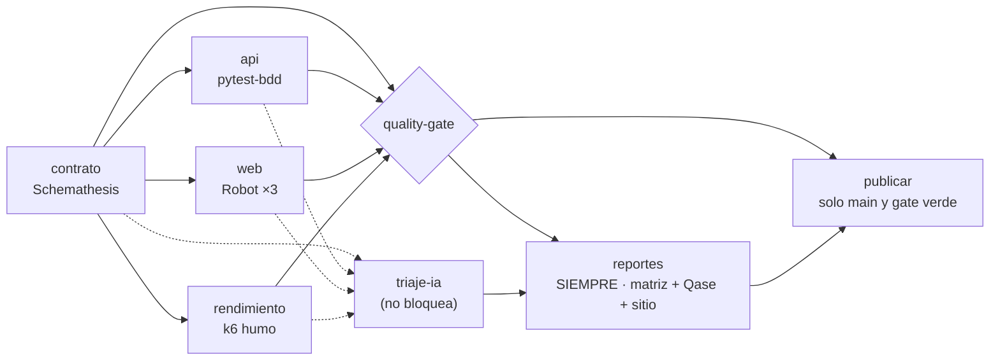

# Informe final del proyecto · Grupo G2 (individual)

**Módulo:** G2 · Pago de servicios y afiliaciones · **Integrante:** David Marcelo · **Curso:** CS5383 Pruebas y Verificación de Software
**Evidencia publicada:** https://deyvydt.github.io/qolqe-wallet-services/ · **Versión entregada:** tag `final` del repositorio

## Índice

1. [Alcance y criterio de selección de escenarios a automatizar](#1-alcance-y-criterio-de-selección-de-escenarios-a-automatizar)
2. [Arquitectura y herramientas](#2-arquitectura-y-herramientas)
3. [Patrón de diseño](#3-patrón-de-diseño)
4. [Cobertura: reporte total de escenarios](#4-cobertura-reporte-total-de-escenarios)
5. [Pipeline CI/CD: estructura y justificación de cada job](#5-pipeline-cicd-estructura-y-justificación-de-cada-job)
6. [Quality Gates](#6-quality-gates)
7. [Trazabilidad con ejecuciones múltiples](#7-trazabilidad-con-ejecuciones-múltiples)
8. [Capacidad de IA: agente de triaje en el pipeline y rf-mcp en las pruebas web](#8-capacidad-de-ia-en-el-pipeline-triaje-de-fallas)
9. [Defectos](#9-defectos)
10. [Rendimiento](#10-rendimiento)
11. [Conclusiones, limitaciones y trabajo futuro](#11-conclusiones-limitaciones-y-trabajo-futuro)

---

## 1. Alcance y criterio de selección de escenarios a automatizar

| Parte | Nivel de prueba | Qué cubre |
|---|---|---|
| 1 · API | Integración por la interfaz HTTP | Los 9 endpoints `/api/servicios/*` (E1–E9) y el proceso diario de débitos (E10), con escenarios funcionales y técnicos; además, pruebas de API del **núcleo común** |
| 2 · Web + CI/CD | Sistema (E2E en navegador) | Núcleo común (HU-N-01…09) y G2 (HU-G2-01…07) por pantalla. Pipeline en GitHub Actions |
| 3 · Rendimiento | Sistema (carga) | Requerimiento «Quincena Qolqe»: carga, pico, estrés y resistencia con k6 |

### 1.1 Matriz de criterios

Cada escenario candidato se puntúa con cuatro criterios (Alto = 3 · Medio = 2 · Bajo = 1). Se automatiza si la suma es **≥ 9**; el **nivel** (API o web) lo decide la pirámide de pruebas: por web va solo lo que el usuario **ve y hace**; cálculos por fecha, concurrencia, seguridad y contrato van por API, que es más rápida y estable.

| Criterio | Pregunta | Alto (3) | Bajo (1) |
|---|---|---|---|
| Riesgo de negocio / dinero | ¿Qué se pierde si falla? | Mueve dinero, cobra mora, expone datos de otro usuario | Cosmético (alias, orden de una lista) |
| Frecuencia de uso | ¿Cuántas veces lo usa el cliente? | Cada sesión (login, pagar, consultar deudas) | Ocasional (desafiliar, cerrar cuenta) |
| Determinismo / costo de automatizar | ¿Se puede repetir con el mismo resultado y a bajo costo? | Datos semilla + reloj y saldo fijables por `/api/pruebas/*` | Depende de terceros reales, de la vista humana o de hardware |
| Estabilidad del requisito | ¿Cambia poco? | Regla escrita con CA y valores (R-G2-0x, RN-xx) | Interfaz o texto que aún cambia |

### 1.2 Qué se automatizó y qué no

| Escenario | Riesgo | Frec. | Determ. | Estab. | Suma | Decisión y nivel | Por qué |
|---|:-:|:-:|:-:|:-:|:-:|---|---|
| Pagar una deuda (HU-G2-02) | 3 | 3 | 3 | 3 | 12 | ✅ API + web | Mueve dinero; flujo principal del usuario |
| Mora y días de atraso según la fecha (R-G2-03, R-G2-04) | 3 | 3 | 3 | 3 | 12 | ✅ API (valores límite 0/1/19/20/21/60 días); web solo 2 ejemplos | Depende de la fecha: se fija con `PUT /api/pruebas/reloj` y se vuelve determinista. Por web sería lento repetir cada día límite |
| Comprobantes de otro usuario (HU-G2-03) | 3 | 2 | 3 | 3 | 11 | ✅ API (`@seguridad`) | Exposición de datos; no se ve en pantalla |
| Pago concurrente de la misma deuda | 3 | 1 | 2 | 3 | 9 | ✅ API (`@concurrencia`, E3) | La web no puede lanzar solicitudes simultáneas de forma confiable |
| Débito automático y SMS de aviso (HU-G2-05) | 3 | 2 | 3 | 3 | 11 | ✅ API (E10 + `procesar-diario`) | Lo ejecuta el Sistema, no una pantalla; el SMS simulado se verifica en `/api/pruebas/notificaciones` |
| Afiliar, alias, desafiliar (HU-G2-03…06) | 2 | 2 | 3 | 3 | 10 | ✅ API + web | CRUD con reglas (R-G2-05, `DEBITO_ACTIVO`) |
| Contrato OpenAPI, autenticación, métodos no declarados | 2 | 3 | 3 | 3 | 11 | ✅ API (Schemathesis + `@tecnico`) | Generación barata desde el contrato |
| **Núcleo común:** registro, login, bloqueo al 3.er intento, cierre de sesión, perfil, transferencias | 3 | 3 | 3 | 3 | 12 | ✅ web (`features/e2e/nucleo_comun.feature`, 13 escenarios) + pruebas de API del núcleo común (`@N<n>`) | Lo usan todos los módulos: si se rompe el login, se cae G1…G6 |
| **Núcleo común:** cerrar cuenta (con saldo → rechazo; con S/ 0.00 → cierre) | 3 | 1 | 3 | 3 | 10 | ✅ web | Irreversible para el cliente; se prueba la regla que lo impide con saldo |
| Recepción real del SMS en el teléfono | 2 | 2 | 1 | 2 | 7 | ❌ fuera de alcance | Los SMS son simulados en el SUT; se automatiza el **contenido** del mensaje, no la entrega del operador |
| Aspecto visual, usabilidad, accesibilidad, otros navegadores | 1 | 3 | 1 | 1 | 6 | ❌ manual / exploratoria | Requiere juicio humano; la suite corre solo en Chromium headless |
| Carga, pico, estrés y resistencia completas (13–33 min) | 3 | 1 | 2 | 3 | 9 | ✅ automatizadas, **ejecución manual** (`ejecutar.py`) | Demasiado largas para cada PR; en CI corre un humo de ~1 min (§6) |
| Módulos G1, G3–G6 | — | — | — | — | — | ❌ otros grupos | Fuera del módulo asignado; la estructura los admite (§3.4) |

---

## 2. Arquitectura y herramientas

### 2.1 Arquitectura planteada

```mermaid
flowchart LR
    subgraph SUT["Qolqe Wallet (FastAPI + SQLite) · NO se modifica"]
        API["API REST /api/*<br/>contrato /openapi.json"]
        UI["Web /servicios, /login…<br/>(data-testid)"]
        SOP["API de soporte /api/pruebas/*<br/>reiniciar · reloj · saldo · procesar-diario"]
    end

    subgraph SPEC["Especificación"]
        REQ["docs/requisitos.md<br/>HU · CA · reglas"]
        FAPI["features/api/*.feature<br/>Gherkin (es)"]
        FE2E["features/e2e/*.feature<br/>Gherkin (es)"]
    end

    REQ --> FAPI & FE2E

    FAPI --> BDD["pytest-bdd + httpx<br/>(TestClient, en proceso)"]
    BDD --> API
    BDD --> SOP
    ST["Schemathesis<br/>(desde el contrato)"] --> API

    FE2E --> RF["Robot Framework<br/>+ GherkinParser"]
    RF --> PO["Page Objects<br/>tests/e2e/pages"] --> BR["Browser Library<br/>(Playwright, Chromium)"] --> UI

    K6["k6<br/>tests/performance/qolqe.js"] --> API

    subgraph CI["GitHub Actions"]
        PIPE["contrato → api ‖ web ‖ rendimiento<br/>→ quality-gate → reportes → publicar → reporte-final"]
    end
    BDD & ST & RF & K6 -.JUnit XML / output.xml / JSON.-> PIPE
    PIPE --> PAGES["GitHub Pages<br/>reportes + matriz de trazabilidad"]
    PIPE --> QASE["Qase<br/>historial de runs por caso"]
    PIPE --> TRI["Triaje de fallas<br/>(Claude, solo sugiere)"]
```

| Aspecto | **API** | **Web** |
|---|---|---|
| Especificación | `features/api/*.feature` (Gherkin en español) | `features/e2e/*.feature` (Gherkin en español) + 3 casos `tests/e2e/*.robot` |
| Ejecutor | pytest + pytest-bdd | Robot Framework + `robotframework-gherkin-parser` |
| Patrón | Steps genéricos → helpers → cliente (§3.2) | Page Object + App Actions (§3.1) |
| Cliente / driver | `httpx` vía `TestClient`, **en proceso** (sin servidor) | Browser Library (Playwright, Chromium headless) contra uvicorn |
| Datos y precondiciones | `/api/pruebas/reiniciar`, reloj y saldo fijados; BD propia de pruebas (`tests/conftest.py`) | Login y reinicio por API (App Actions); BD `datos/e2e.db` |
| Defectos conocidos | `xfail strict` con el DEF (`tests/conftest.py`) | `@defecto @DEF-0X` → SKIP con el mensaje original |
| Evidencia | JUnit XML + HTML + reporte total endpoint × tipo | `output.xml`, `report.html`, `log.html` (con o sin capturas) |
| Job del pipeline | `contrato` (`_contrato.yml`) y `api` (`_api.yml`) | `web` (`_web.yml`), 3 ejecuciones seguidas |

**Herramientas complementarias:** Schemathesis (contrato), k6 (rendimiento), Qase (gestión de casos e historial), GitHub Pages (evidencia), Claude API (triaje de fallas, solo sugiere).

### 2.2 Justificación de cada herramienta frente a alternativas

| Necesidad | Elegida | Alternativas evaluadas | Por qué la elegida |
|---|---|---|---|
| API funcional en BDD | **pytest + pytest-bdd + httpx** | Behave, Karate, Postman/Newman | Mismo lenguaje que el SUT (Python) → `TestClient` llama a la app **en proceso**, sin red ni servidor: rápido y estable. Fixtures y `parametrize` de pytest, marcas por etiqueta Gherkin (`-m "E3 and tecnico"`), `xfail strict` para defectos conocidos, JUnit/HTML nativos. **Behave** también lee Gherkin, pero no tiene fixtures ni el ecosistema de plugins de pytest (HTML, xfail, Schemathesis en la misma corrida). **Karate** obliga a JVM y a su propio DSL. **Postman/Newman**: colecciones JSON difíciles de revisar en un PR y sin Gherkin |
| API técnica (contrato) | **Schemathesis** | Dredd | Genera cientos de casos **basados en propiedades** desde `/openapi.json` (tipos, obligatoriedad, cabeceras, métodos no declarados) y corre dentro de pytest. **Dredd** solo valida los ejemplos del contrato (no hace *fuzzing*) y su mantenimiento está detenido |
| Web E2E | **Robot Framework + Browser Library** (+ `robotframework-gherkin-parser`) | Cypress, Playwright Test, Selenium | Browser usa **Playwright** por dentro (auto-espera, trazas, headless), pero con **keywords legibles** y reportes `report.html`/`log.html` con capturas sin configurar nada. El parser permite que el `.feature` en español sea el caso ejecutable. **Cypress** y **Playwright Test** exigen JavaScript/TypeScript (el resto del proyecto es Python). **Selenium** no espera solo: más esperas manuales y más fragilidad |
| Rendimiento | **k6** | JMeter, Locust (y Gatling, Artillery) | Umbrales como código (`thresholds`) que devuelven código de salida ≠ 0 → sirven de **quality gate**; bajo consumo por VU (goroutines), clave porque generador y app comparten la misma máquina. **Locust** es Python, pero por el GIL necesita varios procesos para escalar y le quita CPU a la app. **JMeter**: un hilo de JVM por usuario y planes `.jmx` en XML difíciles de versionar. Detalle: [`docs/rendimiento/herramienta.md`](rendimiento/herramienta.md) |
| Gestión de pruebas / historial | **Qase** | TestRail, Xray, Zephyr Scale, Kiwi TCMS | Plan gratuito, sin Jira ni servidor propio, API REST simple para subir cada run desde el pipeline. **TestRail** es de pago; **Xray** y **Zephyr** requieren Jira; **Kiwi TCMS** es gratis pero hay que instalar y mantener un servidor. Detalle: [`docs/trazabilidad-qase.md`](trazabilidad-qase.md) |
| CI/CD y publicación | **GitHub Actions + GitHub Pages** | GitLab CI, Jenkins | El repositorio ya vive en GitHub: sin infraestructura extra, protección de rama ligada al check, Pages gratis para la evidencia y `GITHUB_TOKEN` con acceso a GitHub Models para el triaje |

---

## 3. Patrón de diseño

### 3.1 Criterios y pesos

Puntuación de 1 (débil) a 5 (fuerte). La **suma ponderada** = Σ (puntaje × peso); el máximo es 5,00.

| Criterio | Peso | Por qué pesa eso |
|---|---:|---|
| Mantenimiento (un cambio de pantalla/endpoint se corrige en un solo lugar) | 25 % | Es el costo principal de una suite E2E a lo largo del curso |
| Escalabilidad a G3…G6 | 20 % | El SUT tiene 6 módulos; la estructura debe admitirlos sin reescribir |
| Curva de aprendizaje | 15 % | Un integrante y otros grupos que lean el código |
| Reutilización del núcleo común | 15 % | Login, registro y transferencias los usan todos los módulos |
| Testabilidad (casos negativos, precondiciones, aislamiento) | 10 % | Se necesitan entradas inválidas y datos controlados |
| Compatibilidad con Robot Framework / Gherkin (pytest-bdd en API) | 15 % | Los `.feature` en español son el caso ejecutable |

### 3.2 Web E2E: comparativa ponderada

| Criterio (peso) | **Page Object** (elegido) | Screenplay | Keyword-driven puro | App Actions (solo) |
|---|:-:|:-:|:-:|:-:|
| Mantenimiento (25 %) | 4 | 5 | 2 | 4 |
| Escalabilidad G3…G6 (20 %) | 4 | 5 | 2 | 3 |
| Curva de aprendizaje (15 %) | 5 | 2 | 5 | 3 |
| Reutilización núcleo común (15 %) | 4 | 5 | 2 | 3 |
| Testabilidad (10 %) | 4 | 4 | 3 | 5 |
| Compatibilidad Robot/Gherkin (15 %) | 5 | 2 | 5 | 4 |
| **Suma simple (máx. 30)** | **26** | 23 | 19 | 22 |
| **Suma ponderada (máx. 5,00)** | **4,30** | 4,00 | 3,00 | 3,60 |

Ejemplo del cálculo (Page Object): 4×0,25 + 4×0,20 + 5×0,15 + 4×0,15 + 4×0,10 + 5×0,15 = 1,00 + 0,80 + 0,75 + 0,60 + 0,40 + 0,75 = **4,30**.

| Patrón | Idea | Fortaleza | Por qué no se eligió / riesgo |
|---|---|---|---|
| **Page Object** | Un `.resource` por pantalla con sus localizadores (`data-testid`) y acciones | Si cambia una pantalla se corrige **un** archivo; encaja con el estilo de keywords de Robot | Page Objects «dios» si no se cuida el tamaño |
| Screenplay | Actores con habilidades que ejecutan tareas y hacen preguntas | El más escalable con muchos equipos y roles | Curva alta y va contra el estilo de keywords de Robot; sobre-ingeniería para 1 módulo y ~6 pantallas |
| Keyword-driven puro | Tablas de keywords sin capa de pantallas | Muy fácil de empezar | Localizadores repetidos en cada caso: frágil y con copia-pega |
| App Actions (solo) | Preparar el estado llamando a la API, no por la UI | Precondiciones rápidas y estables | Por sí solo se salta lo que el usuario hace: se usa **como complemento** |

**Implementación:** 3 capas + App Actions en las precondiciones.
`escenario .feature` (qué) → `features/e2e/pasos/*.resource` (frase → acción de negocio) → `tests/e2e/pages/*Page.resource` (cómo: `data-testid` + acciones) → Browser → navegador.
Las precondiciones (`Dado que Ana inició sesión`) usan **App Actions** (login por API y reinicio de datos por `/api/pruebas/reiniciar`), y lo que el escenario prueba se hace por pantalla.

### 3.3 API: comparativa ponderada

| Criterio (peso) | Service Object (una clase por recurso) | **Steps genéricos + helpers** (elegido) | Cliente generado desde OpenAPI |
|---|:-:|:-:|:-:|
| Mantenimiento (25 %) | 4 | 4 | 3 |
| Escalabilidad G3…G6 (20 %) | 4 | 5 | 4 |
| Curva de aprendizaje (15 %) | 4 | 5 | 3 |
| Reutilización núcleo común (15 %) | 4 | 5 | 3 |
| Testabilidad (10 %) | 4 | 4 | 2 |
| Compatibilidad con Gherkin / pytest-bdd (15 %) | 3 | 5 | 2 |
| **Suma simple (máx. 30)** | 23 | **28** | 17 |
| **Suma ponderada (máx. 5,00)** | 3,85 | **4,65** | 2,95 |

| Patrón | Por qué sí / por qué no |
|---|---|
| **Steps genéricos + helpers** | Frases como `envío "GET" a "/api/…"` y `la respuesta tiene estado 200` sirven a **cualquier** endpoint de cualquier grupo: G3…G6 solo escriben `.feature`. Los helpers (login, reloj, saldo, reinicio) son el núcleo común compartido |
| Service Object | Con 10 endpoints y pasos genéricos, una clase por recurso solo duplicaría lo que ya dicen la ruta y el contrato; y obliga a una frase Gherkin por método de la clase |
| Cliente generado desde OpenAPI | Tipado y siempre al día con el contrato, pero **valida antes de enviar**: no deja mandar un monto como texto inválido o un campo faltante, justo los casos `@tecnico`. Además las frases Gherkin quedan atadas a nombres generados |

| Capa | Dónde | Responsabilidad |
|---|---|---|
| Escenario | `features/api/*.feature` | Qué se prueba, con etiquetas de endpoint, tipo, HU y técnica |
| Steps | `tests/api/conftest.py` | Frases **genéricas** más frases de negocio (mora, saldo, SMS) |
| Helpers | `tests/api/conftest.py`, `tests/conftest.py` | Login, fijar reloj/saldo, reiniciar datos, clasificar resultados por endpoint |
| Cliente | `httpx` / `TestClient` | Envía la solicitud a la app en proceso |

### 3.4 Escalabilidad: qué pasa al agregar G3…G6

| Pieza | Compartida (núcleo común) | Lo que agrega cada grupo |
|---|---|---|
| Web | `nucleo_comun.feature`, `pasos/nucleo.resource`, `LoginPage`, `RegistroPage`, `InicioPage`, `PerfilPage`, `TransferirPage`, `Comun.resource` (fixtures, `EVIDENCIA`) | `features/e2e/gX_*.feature`, `pasos/gX.resource` y su `XPage.resource` |
| API | Pasos genéricos HTTP, login, reinicio de datos, reloj, reporte por endpoint, pruebas de API del núcleo común | `features/api/gX_*.feature`, sus marcas `E…` en `pytest.ini` y los pasos de sus reglas |
| Pipeline | Jobs, quality gate, Pages, Qase y triaje | Nada: los jobs recorren las carpetas; cada grupo se filtra por su tag (`--include G3`, `-m G3`) |

### 3.5 Conclusión y cuándo cambiaríamos de patrón

**Conclusión:** Page Object + App Actions (web, 4,30) y steps genéricos + helpers (API, 4,65) ganan por mantenimiento localizado, curva baja y encaje directo con Gherkin. Screenplay queda segundo (4,00): gana en escalabilidad pero pierde en curva y en compatibilidad con Robot.

| Señal | Cambiaríamos a | Por qué |
|---|---|---|
| Se suman varios equipos (G3…G6) con roles distintos (cliente, operador, administrador) | Screenplay | Los actores y tareas evitan Page Objects gigantes compartidos; el costo de migrar es bajo porque las acciones ya están separadas de los escenarios |
| Un Page Object supera ~30 keywords o mezcla varias pantallas | Componentes (Page Object por componente: menú, tabla, modal) | Vuelve a localizar el mantenimiento |
| Cada grupo repite la misma secuencia de llamadas de API (p. ej. crear afiliación + activar débito) | Service Object para **esas** secuencias | Una sola definición de la secuencia de negocio |
| El contrato se vuelve muy grande y cambia seguido | Cliente generado desde OpenAPI **solo** para los casos funcionales | Los `@tecnico` seguirían con `httpx` directo para poder mandar entradas inválidas |

---

## 4. Cobertura: reporte total de escenarios

Esta sección responde a las observaciones *«no se distinguen los escenarios de todos los endpoints»*, *«reporte total de escenarios»* y *«cobertura completa de casos funcionales y técnicos en las APIs»*. Cada escenario lleva **una etiqueta de endpoint** (`@E1`…`@E10`) y **una de tipo** (`@funcional` o `@tecnico`); `pytest` imprime al final el **REPORTE TOTAL DE ESCENARIOS · endpoint × tipo × resultado** (lo genera `tests/conftest.py` con los resultados de esa misma ejecución).

### 4.1 API G2: endpoint × tipo

Solo módulo G2: **113 escenarios Gherkin + 11 pruebas técnicas (humo y Schemathesis) = 124** (el núcleo común está en la sección 4.2). Técnico = escenarios `@tecnico` del Gherkin + 1 prueba Schemathesis por endpoint.

| Endpoint | Funcional | Técnico | Total | Pasan | Fallo esperado (DEF) |
|---|---:|---:|---:|---:|---|
| E1 `GET /api/servicios/empresas` | 2 | 4 | **6** | 6 | — |
| E2 `GET /api/servicios/deudas` | 17 | 11 | **28** | 24 | 4 (DEF-01, 02, 03) |
| E3 `POST /api/servicios/pagos` | 15 | 5 | **20** | 16 | 4 (DEF-02, 03) |
| E4 `GET /api/servicios/pagos` | 4 | 5 | **9** | 9 | — |
| E5 `GET /api/servicios/pagos/{codigo}` | 2 | 4 | **6** | 6 | — |
| E6 `GET /api/servicios/afiliaciones` | 6 | 3 | **9** | 9 | — |
| E7 `POST /api/servicios/afiliaciones` | 14 | 6 | **20** | 19 | 1 (DEF-01) |
| E8 `PUT /api/servicios/afiliaciones/{id}` | 4 | 6 | **10** | 10 | — |
| E9 `DELETE /api/servicios/afiliaciones/{id}` | 4 | 4 | **8** | 8 | — |
| E10 `POST /api/pruebas/procesar-diario` | 4 | 2 | **6** | 5 | 1 (DEF-04) |
| Otros (humo, métodos no declarados) | 0 | 2 | **2** | 2 | — |
| **Total** | **72** | **52** | **124** | **114** | **10** · 0 fallos nuevos |

Además, Schemathesis generó **945 solicitudes** desde el contrato en esa ejecución, con **0 errores 500**.

**Por técnica de diseño (escenarios Gherkin):** camino feliz 8/8 · partición 31/31 · valores límite 23/32 (los 9 restantes son fallos esperados) · efecto 8/8 · concurrencia 1/1 · seguridad 17/17 · contrato 5/5.

**Por HU (Gherkin, sin Schemathesis):** HU-G2-01 32 · HU-G2-02 20 · HU-G2-03 19 · HU-G2-04 8 · HU-G2-05 15 · HU-G2-06 7 · HU-G2-07 12 · humo 1 → 114. **Las 7 HU de G2 tienen escenarios.**

### 4.2 API del núcleo común

Pruebas de API del núcleo común en `features/api/nucleo_comun.feature`, con etiquetas de endpoint `@N<n>` (mismo esquema que `@E<n>` de G2) y de tipo `@funcional` / `@tecnico`.

| Endpoint del núcleo | Funcional | Técnico | Total | Pasan | Fallo esperado |
|---|---:|---:|---:|---:|---|
| N1 `POST /api/usuarios` | 17 | 4 | **21** | 20 | 1 (DEF-08) |
| N2 `POST /api/auth/login` | 10 | 5 | **15** | 14 | 1 (DEF-09) |
| N3 `POST /api/auth/logout` | 3 | 2 | **5** | 4 | 1 (DEF-07) |
| N4 `GET /api/cuentas/me` | 1 | 4 | **5** | 5 | 0 |
| N5 `PUT /api/cuentas/me` | 10 | 2 | **12** | 12 | 0 |
| N6 `GET /api/cuentas/me/saldo` | 1 | 2 | **3** | 3 | 0 |
| N7 `POST /api/cuentas/me/cierre` | 5 | 2 | **7** | 7 | 0 |
| N8 `POST /api/transferencias` | 25 | 8 | **33** | 29 | 4 (DEF-10, 12, 13, 14) |
| N9 `GET /api/transferencias/comision` | 10 | 5 | **15** | 14 | 1 (DEF-11) |
| **Total núcleo** | **82** | **34** | **116** | **108** | **8** · 0 fallos nuevos |

Estas pruebas destaparon **8 defectos reales del núcleo común** (DEF-07 a DEF-14, sección 9), entre ellos que cerrar sesión no invalida el token y que el saldo puede quedar negativo. **Total de API del proyecto: 124 (G2) + 116 (núcleo) = 240 pruebas.**

### 4.3 Web: escenarios por HU

27 escenarios Gherkin (`features/e2e`) + 3 casos `.robot` (`tests/e2e`) = **30 pruebas web**.

| Archivo | HU | Escenarios | Notas |
|---|---|---:|---|
| `nucleo_comun.feature` | HU-N-01…09 | 13 | Registro, login (incl. 2 credenciales erróneas y bloqueo), cierre de sesión, perfil, cierre de cuenta, transferencias Qolqe e interbancaria con comisión |
| `g2_servicios.feature` | HU-G2-01…07 | 14 | Pagar luz y agua (CP-W01/02), mora R-G2-03 (2 ejemplos, `@DEF-02`), sin deudas, suministro corto, afiliar (CP-W03) y suministro inexistente, alias, débito, desafiliar (con y sin débito), filtrar pagos, refresco tras desafiliar (`@DEF-06`) |
| `tests/e2e/*.robot` | HU-G2-01/02/03 | 3 | CP-W01, CP-W02, CP-W03 en estilo `.robot` |

Resultado esperado de la suite: `30 tests, 28 passed, 0 failed, 2 skipped` (los 2 *skip* son DEF-02; si aparece DEF-06 en el login por pantalla, ese escenario sale *skip* solo con la firma exacta del defecto; cualquier otro fallo es *fail*).

### 4.4 Cómo se leen las etiquetas

| Etiqueta | Significado | Filtro |
|---|---|---|
| `@E1`…`@E10` | Endpoint de G2 (lista en `pytest.ini`) | `pytest -m E3` |
| `@N<n>` | Endpoint del núcleo común | `pytest -m N1` |
| `@funcional` / `@tecnico` | Tipo: regla de negocio/CA vs. autenticación, validación de entrada, contrato, método HTTP | `pytest -m "tecnico and E7"` |
| `@seguridad`, `@contrato` | Subtipos técnicos | `pytest -m seguridad` |
| `@HU-G2-0x`, `@HU-N-0x`, `@CAn`, `@R-G2-0x`, `@RN-xx` | Trazabilidad a la especificación | `pytest -m HU-G2-02` · `robot --include HU-G2-02` |
| `@camino-feliz`, `@particion`, `@valor-limite`, `@efecto`, `@concurrencia` | Técnica de diseño | `pytest -m valor-limite` |
| `@defecto @DEF-0X` (web) | Escenario que hoy falla por un defecto conocido → SKIP con el mensaje original | `--skiponfailure defecto` |
| `CP-Wxx` | Caso web del plan | `robot --include CP-W01` |

---

## 5. Pipeline CI/CD: estructura y justificación de cada job

### 5.1 Grafo

Copiado de la cabecera de [`.github/workflows/pruebas.yml`](../.github/workflows/pruebas.yml):

```
  contrato ─┬─► api ──────────┐
            ├─► web ──────────┼─► quality-gate ─► reportes ─► publicar (solo main) ─► reporte-final
            └─► rendimiento ──┘        triaje-ia ──┘
```



**Eventos:** push a `main`, pull request hacia `main` y manual (`workflow_dispatch`) con 3 inputs: `suite` (`todas` | `api` | `web`), `repeticiones` (`1` | `3`, por defecto 3) y `evidencia` (`con` | `sin`). `concurrency` cancela el run anterior de la misma rama, salvo en `main` (no se corta un deploy de Pages a la mitad).

### 5.2 Cada job y su justificación

| # | Job | Archivo | Depende de | Condición (`if`) | Por qué existe | Por qué en ese lugar |
|---|---|---|---|---|---|---|
| 1 | `contrato` | `_contrato.yml` | — | siempre | Comprueba que el OpenAPI se genera con las rutas de G2 y corre Schemathesis (`pytest tests/tecnico`) | **Primero (fail fast):** es lo más barato y si la API incumple su contrato no tiene sentido gastar minutos en lo demás |
| 2 | `api` | `_api.yml` | `contrato` | contrato en verde y `suite ≠ web` | Escenarios Gherkin funcionales y técnicos E1–E10 con el reporte total endpoint × tipo; además, pruebas unitarias de las herramientas del pipeline (`tests/triaje`, `tests/qase`) | En **paralelo** con web y rendimiento: son independientes |
| 3 | `web` | `_web.yml` | `contrato` | contrato en verde y `suite ≠ api` | Escenarios E2E en Chromium headless, **N veces seguidas** (3 por defecto) para demostrar que la suite no es frágil | En paralelo; es el job más lento |
| 4 | `rendimiento` | `_rendimiento.yml` | `contrato` | contrato en verde y `suite` = `todas` (o push/PR) | k6 `humo` (~1 min) con los mismos umbrales del requerimiento: detecta una regresión grave de latencia o de integridad del dinero | En paralelo; la batería larga (13–33 min) se corre fuera del pipeline |
| 5 | `quality-gate` | `pruebas.yml` | `contrato, api, web, rendimiento` | `!cancelled()` | **Único punto de decisión** verde/rojo con criterios explícitos (§6) | Después de todas las pruebas; es el check que protege `main` |
| 6 | `triaje-ia` | `pruebas.yml` | `contrato, api, web, rendimiento` | `!cancelled()` + `continue-on-error: true` | Hipótesis de causa para cada falla nueva y validación del triaje contra 10 casos etiquetados (§8) | En paralelo con el gate; **nunca decide** el resultado |
| 7 | `reportes` | `pruebas.yml` | `quality-gate, triaje-ia` | `!cancelled()` → **corre SIEMPRE**, también si hubo fallas | Junta los artefactos, arma la matriz de trazabilidad y la portada, sube la ejecución a Qase y guarda el sitio como artefacto `sitio-reportes` (también en PR y ramas) | **Último job de pruebas:** la evidencia queda visible al final de cada ejecución, pase o falle |
| 8 | `publicar` | `pruebas.yml` | `quality-gate, reportes` | `main` **y** gate en verde **y** reportes en verde (en manual, solo con `suite = todas`) | Publica el sitio en GitHub Pages | Al final y solo con el gate en verde: nunca se publica un estado en rojo |
| 9 | `reporte-final` | `pruebas.yml` | todos los anteriores | Siempre (`!cancelled()`) | Último job: imprime el reporte consolidado en consola; solo informa, no decide el gate |

### 5.3 Reportería con / sin evidencia

**Reporte en consola:** el último job, `reporte-final`, corre siempre e imprime en el log el veredicto, los quality gates, los totales por suite, la cobertura por endpoint, los defectos detectados, las fallas nuevas y los enlaces (`.github/scripts/reporte_consola.py`). El detalle navegable sigue en Pages y el historial en Qase.

| `evidencia` | Qué se genera | Para qué |
|---|---|---|
| `con` (por defecto, también en push y PR) | Captura de página completa al final de cada prueba web + traza Playwright si falla + reportes HTML | Auditoría y demostración |
| `sin` | Sin capturas (ni la automática al fallar) y, en CI, sin trazas de Playwright: el artefacto queda con **0 imágenes** | Corridas rápidas y reportes livianos |

Se aplica con `-v EVIDENCIA:con|sin` en Robot (`tests/e2e/resources/Comun.resource`); un valor distinto de `con`/`sin` hace fallar el teardown para no equivocarse en silencio. En ambos casos el job `reportes` genera el sitio y la matriz.

---

## 6. Quality Gates

Un *quality gate* es una condición medible que un cambio debe cumplir para fusionarse. Cada job de pruebas tiene **su** gate (sale en rojo si no lo cumple) y el job **`quality-gate`** los junta en una tabla en el resumen del run y en un único resultado. Ese job es el check requerido para fusionar en `main`.

### 6.1 Tabla de gates

| Gate | Qué protege | Cómo se mide | Umbral | Dónde se ve (job / resumen) | ¿Bloquea el merge? | Ejemplo de falla |
|---|---|---|---|---|---|---|
| **1 · Contrato** | A los consumidores de la API: que responda según su OpenAPI | `_contrato.yml`: paso que exige que `app.openapi()` tenga versión y ≥ 4 rutas `/api/servicios`; luego `pytest tests/tecnico` (Schemathesis genera casos válidos, inválidos, sin token y con otros métodos para E1–E9) | **0 respuestas 5xx** y cada validación con la respuesta correcta | Job *Contrato · OpenAPI + Schemathesis* · resumen «Contrato (Schemathesis)» · artefacto `reportes-contrato` | **Sí.** Además, si falla, `api`, `web` y `rendimiento` no corren (quedan *skipped*) y el gate agregado se pone en rojo igual, para no dar un falso verde | Un entero enorme en `monto` devuelve 500 en vez de 422 |
| **2 · API** | Las reglas de negocio y validaciones de E1–E10 | `_api.yml`: `pytest` (pytest-bdd) con JUnit XML; `tests/conftest.py` marca los fallos ligados a un DEF como `xfail(strict=True)`. En el mismo job, `pytest tests/triaje tests/qase` | **0 fallos nuevos.** Defectos conocidos DEF-01…04 y DEF-07…14 como `xfail strict`: si uno se corrige y la prueba pasa (**XPASS**), el job falla para actualizar la lista | Job *API · pytest-bdd* · resumen «Pruebas de API (pytest-bdd)» · REPORTE TOTAL endpoint × tipo en el log · artefacto `reportes-api` | **Sí** | Un cambio acepta suministros de 7 dígitos → escenario de partición `failed` (nuevo) → rojo. O se corrige DEF-02 sin quitarlo de la lista → XPASS → rojo |
| **3 · Web** | Lo que el usuario ve y hace, y que la suite sea **estable** | `_web.yml`: Robot corre la suite `repeticiones` veces seguidas (3 por defecto) y cuenta las ejecuciones en verde; `--skiponfailure defecto` | **Todas las ejecuciones seguidas en verde** (3 de 3). SKIP **solo** para escenarios etiquetados `@defecto` (DEF-02, DEF-06), con el mensaje original | Job *Web · Robot Framework + Browser* · resumen «Estabilidad web: N de 3 ejecuciones seguidas en verde» y tabla «Omitidas por defecto conocido» · artefacto `reportes-web` | **Sí** | Un escenario sin `@defecto` falla en la 2.ª de 3 ejecuciones (prueba frágil o regresión) → 2 de 3 → rojo |
| **4 · Rendimiento (humo)** | Que un cambio no degrade la latencia ni descuadre el dinero | `_rendimiento.yml`: `ejecutar.py humo` (k6, 2 VUs, ~1 min) y lectura de `resultados/humo/analisis.json` (`umbrales_k6_cumplidos` e `integridad_dinero.ok`) | **p95 consultas < 800 ms · p95 operaciones de dinero < 1 500 ms · errores técnicos < 1 %** e **integridad del dinero**: ningún descuadre, ningún código repetido, ninguna deuda pagada 2 veces | Job *Rendimiento · k6 humo* · resumen «Rendimiento · humo k6» (Umbrales k6 ✅/❌, Integridad del dinero ✅/❌) · artefacto `reportes-rendimiento` | **Sí** (cuando corre: push, PR o manual con `suite = todas`) | Una consulta sin índice lleva el p95 de deudas a 900 ms → umbral ❌ → rojo |
| **5 · Quality gate agregado** | `main`: que nada en rojo se fusione | Job `quality-gate`: lee `needs` de `contrato, api, web, rendimiento` | Ningún gate en `failure` o `cancelled`, y `contrato` en `success`. Un gate `skipped` por elección de `suite` se muestra como «no aplica» | Job *Quality gate* · tabla **«Quality gate» (Criterio · Umbral · Resultado)** y la línea «Resultado: ✅/❌» en el resumen del run | **Sí: es el check requerido de `main`** | Cualquiera de los ejemplos anteriores |
| Triaje IA | — (orienta el análisis) | Job `triaje-ia` | — | Artefacto `triaje-ia` (`triaje.json`, `validacion.md`) | **No** (`continue-on-error: true`) | Si GitHub Models no responde, el job falla y el run sigue igual |
| Qase | — (historial entre ejecuciones) | Paso «Subir esta ejecución a Qase» en `reportes` | — | Proyecto Qase `QOLQE` | **No** (`continue-on-error: true`; sin token imprime «Qase no disponible» y termina bien) | Token vencido: el run se completa sin subir a Qase |

### 6.2 Cómo se lee en un run

1. Abrir el run en *Actions* → el resumen muestra primero la tabla **Quality gate** con un renglón por gate (✅ aprobado · ⏭️ no aplica · ❌ FALLÓ · ⚠️ cancelado).
2. Si hay ❌, bajar a la sección del job correspondiente del mismo resumen (contrato, API, estabilidad web, omitidas por defecto, rendimiento).
3. Las causas sugeridas por la IA están en el artefacto `triaje-ia`; la evidencia completa, en el artefacto `sitio-reportes` (en `main`, también en GitHub Pages).

---

## 7. Trazabilidad con ejecuciones múltiples

| Fuente | Qué muestra | Dónde |
|---|---|---|
| Matriz de un run | HU → caso → nivel (api/contrato/web) → resultado → DEF | `trazabilidad.html` en Pages, resumen del run y [`docs/trazabilidad.md`](trazabilidad.md) (generada por `.github/scripts/trazabilidad.py`) |
| Historial de muchos runs | Cada ejecución del pipeline es un *test run* de Qase; la ficha de cada caso muestra en qué runs pasó, falló o se omitió | Proyecto Qase `QOLQE`: https://app.qase.io/project/QOLQE · detalle en [`docs/trazabilidad-qase.md`](trazabilidad-qase.md) |

### 7.1 Cómo se ve el historial con múltiples ejecuciones

| En GitHub Actions | En Qase | Cómo se relacionan |
|---|---|---|
| Cada run del workflow *Pruebas G2* (push, PR o manual) | Un **test run** nuevo titulado `Run #<número> · <rama>`, con el commit y el enlace al run de GitHub | `qase_subir.py` en el job `reportes` |
| Cada prueba (escenario Gherkin, prueba Schemathesis, caso Robot) | Un **caso** del repositorio de Qase, en su suite (*API - Funcional*, *API - Técnico*, *Web E2E - Núcleo común*, *Web E2E - G2 Servicios*) | El título es estable (`[nivel] nombre`): se busca por título y se reutiliza, así cada run suma historial al **mismo** caso |
| Resultado: pasa / falla / omitida / xfail | `passed` / `failed` (con el mensaje) / `skipped` / `skipped` con «Fallo esperado: defecto conocido DEF-0X» | Mapeo en `qase_subir.py`, probado en `tests/qase/test_qase_subir.py` |
| Varios runs seguidos | Lista *Test Runs* con el % de casos que pasan; ficha del caso → historial en todos los runs | Permite ver en qué commit apareció una regresión o que DEF-02 sigue omitido run tras run |
| Primer run subido | https://app.qase.io/run/QOLQE/dashboard/1 : **153 casos ejecutados** | Línea base del historial |

Las etiquetas del Gherkin (`@HU`, `@CA`, `@E`) viajan en el JUnit XML y en el `output.xml` de Robot y llenan los campos propios *Endpoint* e *Historia de usuario* de Qase.

### 7.2 Investigación: herramienta de gestión de casos

Resumen de [`docs/trazabilidad-qase.md`](trazabilidad-qase.md):

| Herramienta | Costo para el curso | Integración con CI | Requiere | Veredicto |
|---|---|---|---|---|
| **Qase** (elegida) | Gratis (hasta 3 usuarios) | Reporteros para pytest y Robot; API REST v1 simple | Nada (SaaS) | Sube cada run desde el pipeline con un script sin dependencias nuevas |
| TestRail | De pago (prueba de 14 días) | API o CLI `trcli` | Licencia | Descartada por costo |
| Xray | De pago | Importa JUnit / Robot vía Jira | Jira | Descartada: depende de Jira |
| Zephyr Scale | De pago | Importa JUnit vía Jira | Jira | Descartada: depende de Jira |
| Kiwi TCMS | Gratis (código abierto) | Plugins para pytest y Robot | Servidor propio | Descartada: instalar y mantener un servidor |

---

## 8. Capacidad de IA en el pipeline: triaje de fallas

| Aspecto | Descripción |
|---|---|
| Qué hace | Para cada falla **nueva** del run propone categoría (`defecto_real`, `prueba_fragil`, `entorno`), el DEF ya reportado al que corresponde (si alguno), causa probable y siguiente paso |
| Cómo | Agente con Claude (`claude-haiku-5-5`, API de Anthropic; GitHub Models como alternativa) que puede consultar `docs/defectos.md`, el diff del último commit y el código del repo antes de responder (`.github/scripts/triaje_ia.py`) |
| Validación | 10 fallas etiquetadas a mano (`tests/triaje/casos_etiquetados.json`): DEF-01…05 y 5 sintéticas. Se mide exactitud de categoría y de DEF frente a una **línea base por reglas**. Pruebas unitarias sin red en `tests/triaje/test_triaje.py` (corren en el job `api`) |
| Resultados | Línea base por reglas: **9/10** en categoría y **10/10** en DEF. **Modelo (Claude):** **10/10** en categoría y **10/10** en DEF. El job `triaje-ia` repite la validación en cada run y la deja en el artefacto `triaje-ia` (`validacion.md`). Detalle: [`docs/ia/validacion_triaje.md`](ia/validacion_triaje.md) |
| Controles | Salida JSON validada; el DEF solo se acepta si existe en `defectos.md`; **humano en el bucle** (solo sugiere: no marca xfail ni abre/cierra defectos); nunca bloquea el pipeline; se filtran tokens/contraseñas de las trazas |
| Límites | 10 casos son pocos (resultado orientativo); la línea base es optimista porque sus reglas salen de las mismas huellas de `defectos.md`; un timeout de carga (DEF-05) es difícil de separar de «entorno» |

**Resultado de la validación con el modelo (Claude `claude-haiku-5-5`, 10 casos etiquetados, 20/11/2026):** el agente acierta **10/10** en categoría y **10/10** en defecto asignado, frente a **9/10** y **10/10** de la línea base por reglas. Consultó herramientas (`leer_defectos`, `leer_fragmento_codigo`) en los 10 casos y corrigió el caso C09 (prueba frágil por timing) que las reglas clasificaban como defecto real. Detalle caso por caso en `docs/ia/validacion_triaje.md`. **Límite:** 10 casos, con 5 defectos que el agente puede leer en `docs/defectos.md`; mide el reconocimiento de lo documentado, no generalización, y por eso el triaje solo sugiere.

### 8.1 IA en la construcción de las pruebas web (rf-mcp)

Además del agente de triaje del pipeline, la IA se usó antes para **crear casos E2E**, siempre con revisión humana. El registro de aquella entrega está en el historial de git (commits `d64cbc6` y `f926b38`).

| Herramienta | Tarea | Qué aceptamos | Qué corregimos o descartamos, y por qué |
|---|---|---|---|
| **rf-mcp** (servidor MCP de Robot Framework + Browser Library) con un asistente de código | Generar **en vivo** el caso «Ana paga su recibo de agua» (CP-W02, `tests/e2e/pago_agua.robot`): el agente ejecutó cada paso en un navegador real y luego emitió el `.robot` | Los `data-testid` que encontró, el orden de los pasos y las aserciones del comprobante (S/ 45.00 y saldo S/ 1,455.00): pasaron en vivo | El `.robot` crudo repetía selectores sueltos, dejaba fijos la URL, `headless=False` y `slowMo`, no usaba los fixtures, y escribía el PIN con `Fill Text` (queda visible en el log; el Page Object usa `Fill Secret`). Se refactorizó a Page Objects. |
| Asistente de IA (chat) | Caso de afiliación CP-W03 (`tests/e2e/afiliacion.robot`) a partir de `ServiciosPage.resource` | Los pasos y los `data-testid` de afiliación | La primera versión era **frágil**: escribía antes de que la pantalla cargara. Se añadió una espera por condición en `Ir A Pagar Servicios`. |

**Cómo se validó:** cada caso se ejecutó en un navegador real antes de aceptarse y se repitió varias veces seguidas (hoy forman parte de las 3 ejecuciones consecutivas del pipeline, tabla de la sección 6). Lo generado nunca entró tal cual: se revisó, se refactorizó al patrón del proyecto (sección 3) y se comparó contra el comportamiento esperado de las historias de usuario.

**Qué aprendimos:** la IA acelera encontrar localizadores y esqueletos de pasos, pero produce pruebas frágiles y con malas prácticas (esperas fijas, datos sensibles en el log) si no se revisa. Por eso en la entrega final la IA **sugiere** (triaje, generación de borradores) y una persona **decide**.

---

## 9. Defectos

| ID | Título | Regla / requisito | Severidad | Prioridad | Detectado por |
|---|---|---|---|---|---|
| DEF-01 | Se acepta un suministro de 13 dígitos | R-G2-01 | Baja | Media | API E2 y E7 (valores límite) |
| DEF-02 | Los días de atraso se cuentan +1: se cobra mora el mismo día del vencimiento | R-G2-03 | **Alta** | **Alta** | API E2/E3 (5 casos) y web (2 ejemplos) |
| DEF-03 | Una deuda con 60 días pasa a cobranza y no se puede pagar | R-G2-04 | **Alta** | **Alta** | API E2/E3 (2 casos) |
| DEF-04 | El débito automático paga deudas ya vencidas, sin mora | HU-G2-05 CA4 | Media | Media | API E10 |
| DEF-05 | Con ~1 200 usuarios simultáneos el servicio colapsa y no se recupera sin reinicio | «Quincena Qolqe» | **Alta** | Media | k6 estrés |
| DEF-06 | La API responde antes de confirmar la transacción: tras un login la 1.ª petición puede dar 401 y las listas se repintan con datos viejos | Consistencia lectura tras escritura | **Alta** | **Alta** | Web (intermitente); reproducido por API: 109 de 200 respuestas 401 |
| DEF-07 | Cerrar sesión no invalida el token (sigue respondiendo 200) | HU-N-03 CA1 | **Alta** | **Alta** | API N3 |
| DEF-08 | Se acepta el PIN descendente `4321` | RN-03 | Media | Media | API N1 |
| DEF-09 | Un login exitoso no reinicia el contador de intentos fallidos | RN-04 | Media | Media | API N2 |
| DEF-10 | Se puede transferir a una cuenta cerrada | RN-07 · HU-N-06 CA4 | **Alta** | **Alta** | API N8 |
| DEF-11 | La comisión redondea «al par» y no con redondeo comercial (71.00 → 1.06) | RN-09 | Baja | Baja | API N9 |
| DEF-12 | El saldo puede quedar negativo: no se valida que cubra la comisión interbancaria | RN-08 | **Alta** | **Alta** | API N8 |
| DEF-13 | Las transferencias interbancarias no cuentan para el límite diario | RN-06 | **Alta** | **Alta** | API N8 |
| DEF-14 | Transferencias simultáneas superan el límite diario (3 × S/ 500 con límite de S/ 1 000) | RN-06 · HU-N-07 CA5 | **Alta** | **Alta** | API N8 |

Observaciones del contrato (no son defectos funcionales): OBS-01 rango de enteros no documentado, OBS-02 cabecera `Allow` incompleta, OBS-03 regla R-G2-04 que el contrato no puede expresar. Pasos para reproducir, evidencia y causa probable: [`docs/defectos.md`](defectos.md).

---

## 10. Rendimiento

Herramienta k6 v2.1.0; entorno local (i5-11400H, 32 GB, Windows 11), Qolqe en 1 proceso de uvicorn con SQLite. Modelo de carga: 3 000 sesiones/h × 2 min = **100 VUs** en hora punta (ley de Little); campaña = **300 VUs**. Cifras de `tests/performance/resultados/<escenario>/analisis.json` (etapa estable).

| Prueba | Carga | p95 consultas (< 800 ms) | p95 dinero (< 1 500 ms) | Errores técnicos (< 1 %) | Throughput | Integridad del dinero |
|---|---|---|---|---|---|---|
| Carga | 100 VUs · 13 min | 91 ms ✓ | 117 ms ✓ | 0 % ✓ | 3 366 ses/h ✓ | OK |
| Pico (campaña) | 0→300 VUs en 5 min · 16 min | 94 ms ✓ | 120 ms ✓ | 0 % ✓ | 10 194 ses/h | OK |
| Estrés | +200 VUs hasta 1 600 | ✓ hasta 1 000 · ✗ en 1 200 (60 s) | ✓ hasta 1 000 · ✗ en 1 200 | 0 % → 42–100 % | 85 → 20 req/s | OK |
| Resistencia | 100 VUs · 30 min | 92 ms ✓ | 120 ms ✓ | 0 % ✓ | 3 440 ses/h ✓ | OK · memoria plana (84 → 88 MB) |

**Lectura:** cumple hora punta y campaña con margen ~3×; capacidad estimada **~1 000 usuarios simultáneos** (línea base relativa a este equipo, no de producción). En 1 200 VUs colapsa y no se recupera (DEF-05): el lock de escritura de SQLite queda retenido y los 40 hilos del servidor esperan (CPU ≈ 5 % en el colapso, volcado con py-spy). Informe completo: [`docs/rendimiento/Informe_Rendimiento_G2.docx`](rendimiento/Informe_Rendimiento_G2.docx).

---

## 11. Conclusiones, limitaciones y trabajo futuro

### Conclusiones

1. **Cobertura completa del módulo por endpoint:** 113 escenarios Gherkin + 11 pruebas técnicas (humo y Schemathesis) = 124 pruebas de API de G2 sobre sus 10 endpoints, más 116 del núcleo común (N1–N9): **240 pruebas de API** (154 funcionales / 86 técnicas), más **30 pruebas web**. Total **270**; en el run #25: 250 pasan, 18 fallos esperados, 2 omitidas por defecto conocido y 0 fallos nuevos.
2. **Las pruebas encontraron defectos reales:** 14 defectos, 9 de severidad Alta (entre ellos cobro de mora indebido, colapso bajo carga, sesión que no se invalida al salir y saldo que puede quedar negativo).
3. **El pipeline es un quality gate efectivo:** un fallo nuevo, un defecto corregido sin actualizar la lista (XPASS), una prueba web inestable o una regresión de latencia lo ponen en rojo y bloquean el PR (§6).
4. **La técnica importa más que la cantidad:** en G2, 9 de los 10 fallos esperados salieron de **valores límite** (0/1/19/20/21/60 días, 12/13 dígitos).

### Limitaciones (honestas)

| Limitación | Impacto |
|---|---|
| Rendimiento medido en una sola máquina local, con SQLite | Las cifras son una línea base relativa, no capacidad de producción |
| DEF-06 es intermitente y afecta a la web | Se mitiga con login por API y verificación recargando; los escenarios que lo exponen quedan en SKIP, no en verde real |
| Validación del triaje con solo 10 casos, 5 de ellos defectos ya documentados | El 10/10 mide el reconocimiento de lo documentado, no la generalización; por eso el triaje solo sugiere |
| Schemathesis no genera algunos casos (p. ej. «falta un campo», «entero enorme») en modo determinista | Esas validaciones se cubren a mano en el Gherkin, no por generación |
| Trabajo individual | Se priorizó por riesgo (§1.1); G2 completo y el núcleo común por web y API |

### Trabajo futuro

- Ampliar la validación del triaje a ≥ 30 casos etiquetados con redacciones distintas.
- Repetir la prueba de estrés con PostgreSQL, varios workers y un límite de concurrencia (503 rápido) para confirmar la causa de DEF-05.
- Extender la estructura a G3…G6 sobre el núcleo común compartido (§3.4) y evaluar Screenplay si se suman varios equipos (§3.5).
- Pruebas de rendimiento en un entorno separado del generador de carga y como job programado (nocturno), no en cada PR.
